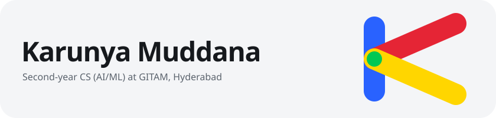
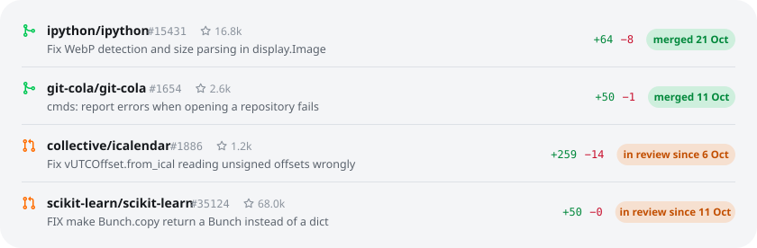
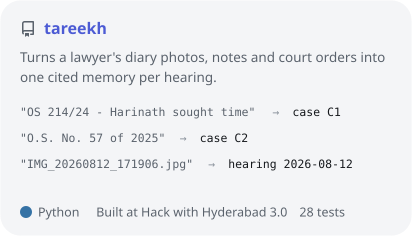
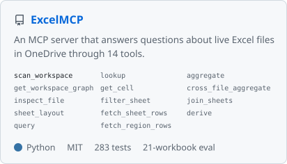
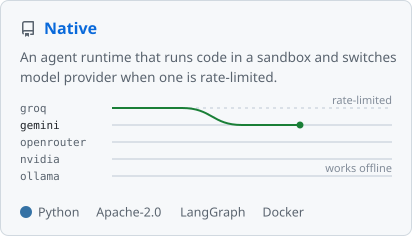
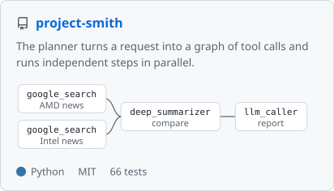
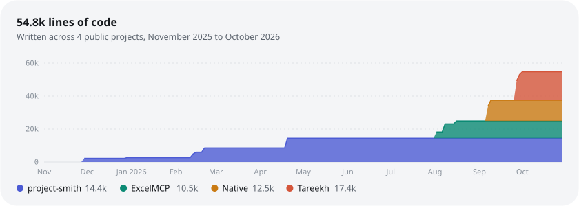
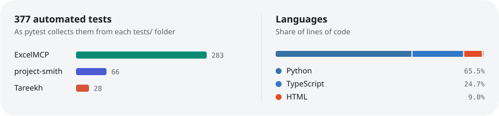

<a href="https://karunya-muddana.github.io"><picture><source media="(prefers-color-scheme: dark)" srcset="assets/header-dark.svg"></picture></a>

I'm a second-year Computer Science (AI/ML) student at GITAM. Right now I'm on a contract building document review for a healthcare certifier in Germany, where the job is checking that an uploaded certificate says what the applicant typed into the form.

The first agent I shipped let a chemical manufacturer's staff ask plain-English questions of their Excel workbooks. Each answer pointed to the sheet and cell behind it, and they used it daily until the company moved to an ERP.

I'm looking for an AI/ML engineering internship. Email [karunya.muddana@outlook.com](mailto:karunya.muddana@outlook.com), or find me on [LinkedIn](https://www.linkedin.com/in/karunya-muddana) and [my portfolio](https://karunya-muddana.github.io).

## Timeline

<picture><source media="(prefers-color-scheme: dark)" srcset="assets/timeline-dark.svg"></picture>

## Open source

<picture><source media="(prefers-color-scheme: dark)" srcset="assets/upstream-dark.svg"></picture>

[ipython#15431](https://github.com/ipython/ipython/pull/15431) · [git-cola#1654](https://github.com/git-cola/git-cola/pull/1654) · [icalendar#1886](https://github.com/collective/icalendar/pull/1886) · [scikit-learn#35124](https://github.com/scikit-learn/scikit-learn/pull/35124)

## Projects

  <a href="https://github.com/Karunya-Muddana/tareekh"><picture><source media="(prefers-color-scheme: dark)" srcset="assets/card-tareekh-dark.svg"></picture></a>
  <a href="https://github.com/Karunya-Muddana/ExcelMCP"><picture><source media="(prefers-color-scheme: dark)" srcset="assets/card-excelmcp-dark.svg"></picture></a>

  <a href="https://github.com/Karunya-Muddana/Native"><picture><source media="(prefers-color-scheme: dark)" srcset="assets/card-native-dark.svg"></picture></a>
  <a href="https://github.com/Karunya-Muddana/project-smith"><picture><source media="(prefers-color-scheme: dark)" srcset="assets/card-smith-dark.svg"></picture></a>

Also: [engraph](https://pypi.org/project/engraph/), long-term memory for Claude Code (`pip install engraph`), and the [CBSE result analyzer](https://github.com/Karunya-Muddana/CBSE-Result-Analyzer-with-Excel-Reports-Python-Pandas-) teachers at two schools used on their board results.

## Code

<picture><source media="(prefers-color-scheme: dark)" srcset="assets/graph-growth-dark.svg"></picture>

<picture><source media="(prefers-color-scheme: dark)" srcset="assets/graph-tests-languages-dark.svg"></picture>

The graphs are counted from the four public repos, and the pull request states come from the GitHub API. [A GitHub Action](.github/workflows/refresh.yml) rebuilds all of it every Monday.

## Tools I use

Python, SQL, TypeScript and C++. For AI work: MCP, LangGraph, RAG and embeddings, OCR, scikit-learn, XGBoost, Pandas and NumPy. For backends: FastAPI, PostgreSQL on Supabase, SQLite, the Microsoft Graph API and pytest. I deploy on Google Cloud and Vertex AI, with Docker.
