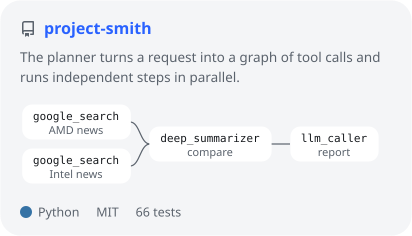

<a href="https://karunya-muddana.github.io"><picture><source media="(prefers-color-scheme: dark)" srcset="assets/header-dark.svg"></picture></a>

I build LLM agents that work on someone's actual files: spreadsheets, scanned certificates, a lawyer's diary. The part I care about most is being able to point at where an answer came from.

I'm looking for an AI/ML engineering internship. Email me at [karunya.muddana@outlook.com](mailto:karunya.muddana@outlook.com) or find me on [LinkedIn](https://www.linkedin.com/in/karunya-muddana). There's more on [my portfolio](https://karunya-muddana.github.io).

## So far

<picture><source media="(prefers-color-scheme: dark)" srcset="assets/timeline-dark.svg"></picture>

## Upstream

<picture><source media="(prefers-color-scheme: dark)" srcset="assets/upstream-dark.svg"></picture>

[ipython#15431](https://github.com/ipython/ipython/pull/15431) · [git-cola#1654](https://github.com/git-cola/git-cola/pull/1654) · [icalendar#1886](https://github.com/collective/icalendar/pull/1886) · [scikit-learn#35124](https://github.com/scikit-learn/scikit-learn/pull/35124)

## Projects

<!-- repos:start -->

  <a href="https://github.com/Karunya-Muddana/ExcelMCP"><picture><source media="(prefers-color-scheme: dark)" srcset="assets/card-excelmcp-dark.svg"></picture></a>
  <a href="https://github.com/Karunya-Muddana/Native"><picture><source media="(prefers-color-scheme: dark)" srcset="assets/card-native-dark.svg"></picture></a>

  <a href="https://github.com/Karunya-Muddana/project-smith"><picture><source media="(prefers-color-scheme: dark)" srcset="assets/card-project-smith-dark.svg"></picture></a>
  <a href="https://github.com/Karunya-Muddana/tareekh"><picture><source media="(prefers-color-scheme: dark)" srcset="assets/card-tareekh-dark.svg"></picture></a>

<!-- repos:end -->

I also benchmarked 11 models on Ames house prices. A tuned XGBoost got to 0.1002 log-RMSE.

## Code

<picture><source media="(prefers-color-scheme: dark)" srcset="assets/graph-growth-dark.svg"></picture>

<picture><source media="(prefers-color-scheme: dark)" srcset="assets/graph-tests-languages-dark.svg"></picture>

[An Action](.github/workflows/refresh.yml) redraws everything here every Monday. It re-ranks the project cards by stars and recent pushes, and re-checks the pull requests above.

## Tools

Mostly Python, plus SQL, TypeScript and some C++. I reach for FastAPI, LangGraph, MCP and pytest, keep data in Postgres on Supabase or SQLite, and deploy with Docker on Google Cloud.
